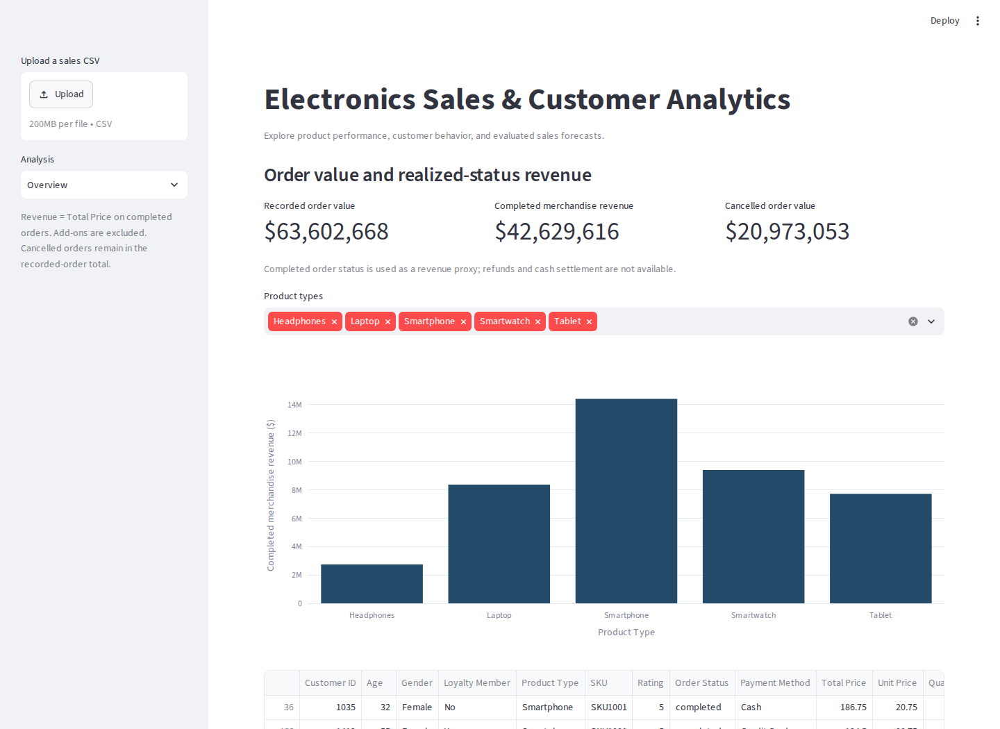
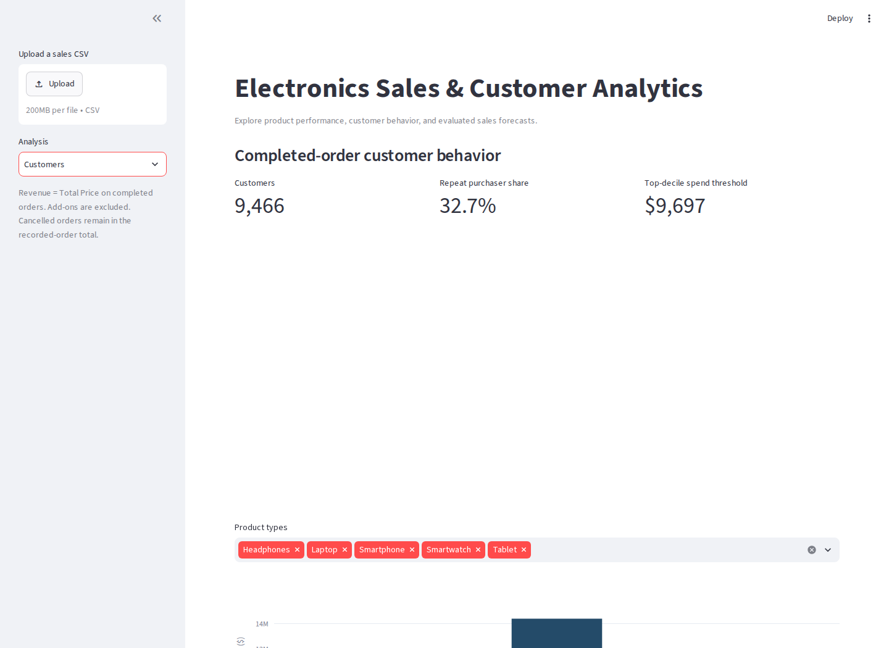
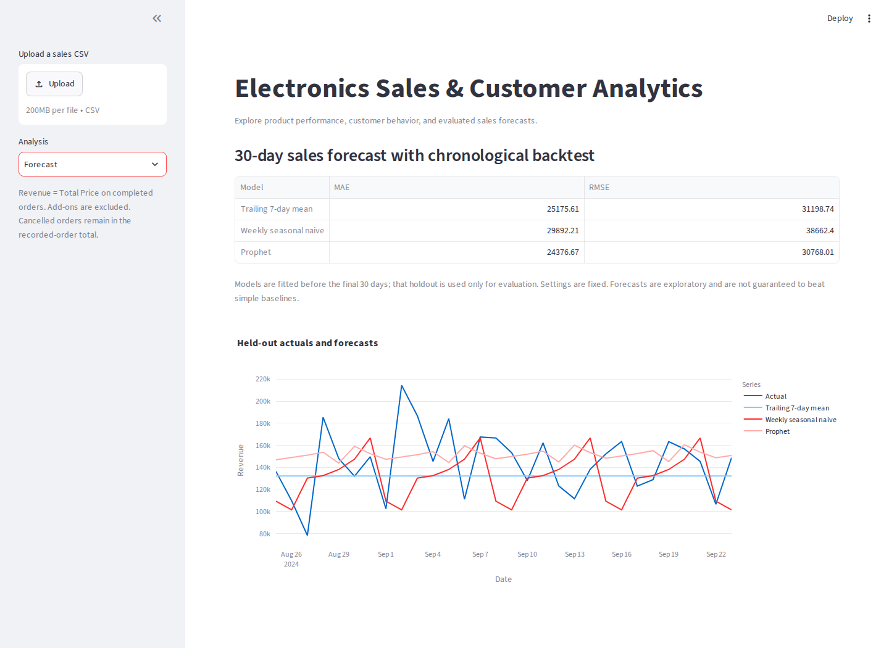

# Electronics Sales & Customer Analytics Dashboard

An interactive Streamlit dashboard for exploring electronics sales, customer purchasing behavior, product performance, and 30-day sales forecasts.

## Business questions
Which products generate completed-order revenue? Who are the repeat and high-spend customers? How does a sales forecast perform against simple alternatives?

## Preview



[Original introduction video](https://www.youtube.com/watch?v=tO_OpAjtfkQ)

## Run locally
```bash
git clone https://github.com/YirenShen-07/SalesAnalyticsDashboard.git
cd SalesAnalyticsDashboard
python -m venv .venv
# macOS / Linux:
source .venv/bin/activate
# Windows PowerShell: .venv\Scripts\Activate.ps1
python -m pip install -r requirements.txt
streamlit run app.py
```
Open the local URL printed by Streamlit. The bundled CSV loads automatically; uploading another CSV is optional. Python 3.12 was used for verification. No Drive, ngrok account, or token is required.

## Definitions and implementation
- **Recorded order value:** Total Price on all valid recorded orders.
- **Completed merchandise revenue:** Total Price only where Order Status is Completed. This is a status-based revenue proxy; settlement, refunds and add-on revenue are not modeled.
- **Cancelled order value:** tracked separately and excluded from revenue, customer spend, product comparisons and forecasting.
- **Repeat purchaser:** more than one completed transaction. **High-spend threshold:** completed spend above the 90th percentile, not predicted lifetime value.
- Latest loyalty status is chosen after chronological sorting. Product order counts are not unique SKU counts.

The bundled data contains 20,000 rows. Completed merchandise revenue is $42,629,615.57; cancelled order value is $20,973,052.80.

Python / Pandas handle cleaning and aggregation; Streamlit and Plotly provide six analysis pages; Prophet models daily completed revenue; scikit-learn provides segmentation and a surrogate tree.

## Forecast evaluation
A fixed final 30-day chronological holdout (2024-08-25 through 2024-09-23) is excluded from fitting. Two baselines and Prophet are evaluated on the same dates; settings are fixed in advance.

| Model | MAE | RMSE |
| --- | --- | --- |
| Trailing 7-day mean | 25175.6113 | 31198.7355 |
| Weekly seasonal naive | 29892.2107 | 38662.4040 |
| Prophet | 24376.6728 | 30768.0119 |

MAE and RMSE are in the dataset's monetary units. On this holdout, Prophet modestly outperforms the baselines; this does not establish general superiority. Annual seasonality is disabled given approximately one year of data. Missing calendar days are treated as zero orders, assuming complete reporting coverage. The displayed 80% Prophet intervals are model-based and have not been coverage-calibrated.

## Explainability
KMeans IDs are arbitrary labels and are never used as a numeric SHAP target. SHAP explains **squared distance to one fixed cluster center** in standardized feature space; positive contributions increase distance, negative contributions reduce it. Computation is bounded to 24 customers and 40 background rows.

LIME explains a **decision-tree surrogate** trained to imitate the current KMeans labels. Held-out agreement with those labels is 98.4%; this measures fidelity to the descriptive segmentation, not predictive business effectiveness. Interventional backgrounds and continuous LIME perturbations can break dependencies or generate unusual customer profiles.

## Reproduce and verify
```bash
python analyze.py
python -m unittest test_analytics.py
```
The [notebook](sales_customer_analytics.ipynb) runs the same analysis module. [Reports](reports/) include metrics, predictions, plots and split metadata. [DATA.md](DATA.md) lists sources and definitions. [SECURITY.md](SECURITY.md) tracks the old tunnel-token remediation separately.

## Project context
Original Duke AIPI 590 project by Yiren Shen. The 2026 portfolio maintenance pass adds reproducibility, evaluation and corrections with AI assistance. No measured sales uplift or production use is claimed.
